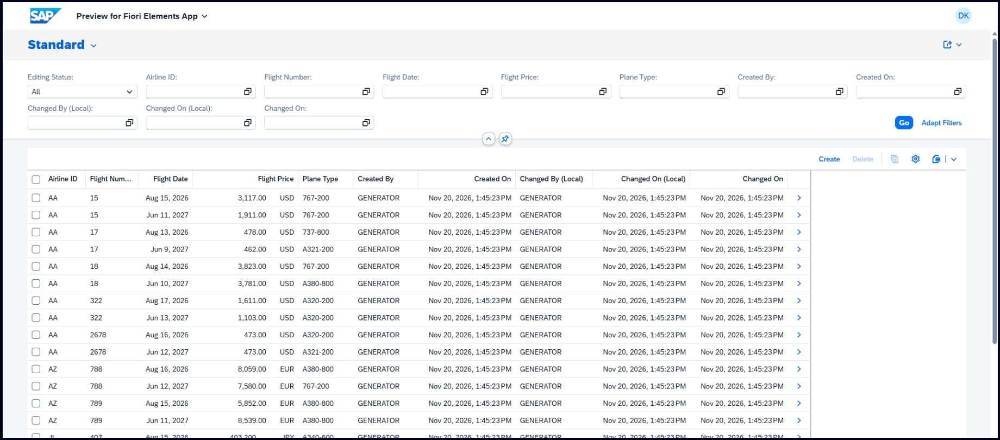
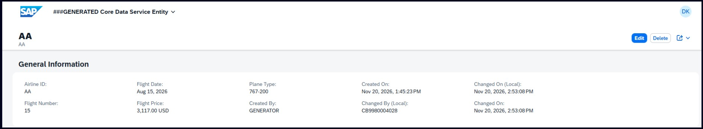
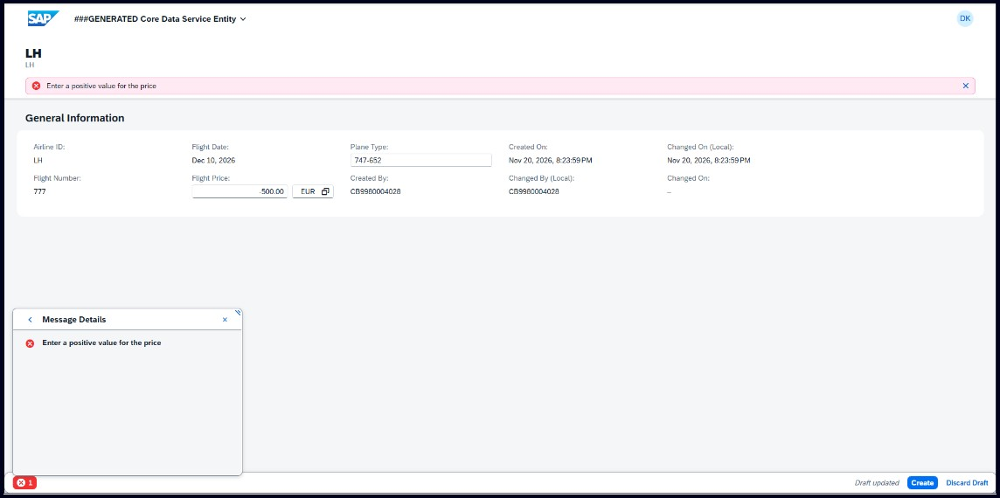

# ABAP RAP – Flight Management Application

A flight management application developed using the **ABAP RESTful Application Programming Model (RAP)** and exposed through an OData V4 UI service.

The application provides a Fiori-based interface for viewing and maintaining flight information, with custom business logic to validate flight prices and control user interactions.

## Project Overview

| Attribute | Details |
|---|---|
| Project | ABAP RAP Flight Management Application |
| ABAP Package | `ZS4D400_3964_FLIGHT` |
| Database Table | `Z3964FLIGHTS` |
| Root CDS View Entity | `ZR_3964FLIGHTS` |
| Projection CDS View | `ZC_3964FLIGHTS` |
| Service Definition | `ZUI_FLIGHTS_04` |
| Service Binding | `ZUI_FLIGHTS_04` |
| Protocol | OData V4 – UI |
| User Interface | SAP Fiori Elements |

## Implemented Features & Business Logic

### 1. Flight Data Management
- Created a dedicated database table based on the SAP flight data template.
- Populated the database table with sample flight records using an ABAP utility class.
- Generated the RAP business object and associated repository objects using the ABAP RAP Object Generator.

### 2. RAP Business Object & OData Service
- Implemented a RAP business object using CDS view entities and behavior definitions.
- Created a root CDS view entity and a projection view to separate the business object data model from its service representation.
- Configured a draft-enabled business object.
- Exposed the business object through an OData V4 UI service using a service definition and service binding.

### 3. Business Logic – Flight Price Validation
Implemented a custom validation (`validatePrice`) in the RAP behavior implementation to enforce a positive flight price.

- Checks whether the flight price is greater than zero.
- Rejects changes when the price is zero or negative.
- Uses Entity Manipulation Language (EML) to read the transactional data.
- Populates the `FAILED` and `REPORTED` response structures to reject invalid records and return an error message to the user.

### 4. User Interface & Behavior Customization
Customized the generated SAP Fiori Elements application through behavior projections and CDS metadata extensions.

- Restricted the service interface to exclude the Create and Delete operations.
- Set the Plane Type field to read-only in the service projection.
- Hid technical and administrative fields, including creation and change timestamps and user information.
- Limited the selection fields on the list report to Carrier ID and Connection ID.
- Adjusted the field sequence on the Object Page for better readability.

## Technologies & Concepts

| Technology | Application |
|---|---|
| ABAP Cloud | Development environment |
| ABAP RESTful Application Programming Model (RAP) | Business object implementation |
| Core Data Services (CDS) | Data modeling and service projections |
| ABAP Behavior Definitions | Business object behavior configuration |
| ABAP Behavior Implementation | Custom validation logic |
| Entity Manipulation Language (EML) | Transactional data access |
| OData V4 | Service exposure |
| SAP Fiori Elements | User interface |
| CDS Annotations | UI metadata and value help configuration |
| Eclipse ADT | ABAP development environment |

## Application Screenshots

### Flight List Report

### Flight Object Page

### Flight Price Validation

## Repository

This repository contains the ABAP development objects for the Flight Management Application.

**Development package:** `ZS4D400_3964_FLIGHT`

**GitHub:** https://github.com/DSKunth/ABAP-RAP-Flight-App
